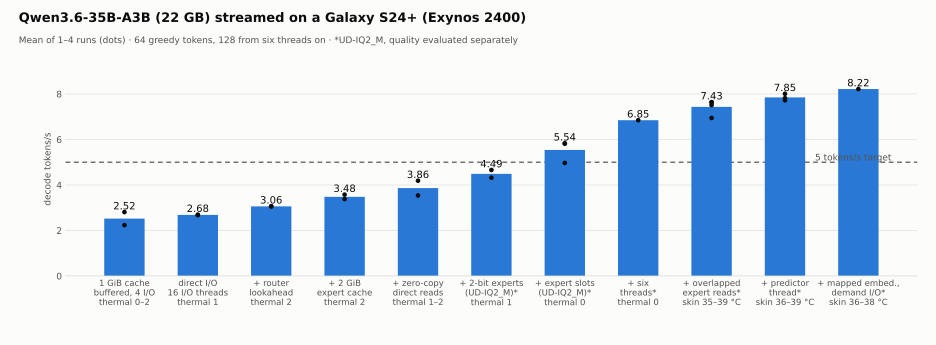
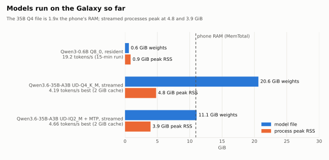

<p align="center"></p>

# Equity (eqt)

**Equity runs language models that do not fit in a phone's RAM — on the phone, offline, at usable speed.**

It is a research inference engine specialised in one model family, the **Qwen3.5/3.6 hybrid-attention mixture-of-experts models** and their Qwen3.8 successor, on one first device, a stock **Samsung Galaxy S24+ (Exynos 2400, 10.9 GiB visible RAM)**. No root, no cloud, no account, no telemetry. Weights stay on the phone's storage and the engine reads only the experts each token needs.

**Website:** [zetawave.github.io/eqt](https://zetawave.github.io/eqt/) · **Benchmarks:** [zetawave.github.io/eqt/benchmarks.html](https://zetawave.github.io/eqt/benchmarks.html) · Developed by **Zetawave**.

## What is true today

All numbers are measured on the Galaxy and recorded in [`results/`](results/).

- **A model twice the phone's RAM runs.** Qwen3.6-35B-A3B (UD-Q4_K_M, 22.7 GB) and its 2.7-bit UD-IQ2_M build (11.9 GB) stream on a stock phone; with a 2 GiB expert cache the app peaks at about 4.6 GiB RSS. Routing is exact: streamed inference is bitwise identical to resident inference on the verification fixtures.
- **Over 5 tokens/s in the app, on both builds, in short answers.** On a cool phone the app answers at 7.4 tokens/s with UD-IQ2_M and 5.1 tokens/s with UD-Q4_K_M (the owner's readings of the app's stats line, ~200-token answers). The engine alone reaches 8.2 tokens/s with UD-IQ2_M (128 tokens, 2 GiB cache), up from 5.45 at the start of the latest session.
- **Sustained speed is not yet re-measured.** The last 10-minute run on battery, with an older build, settled at about 3.5 tokens/s (about 1.07 J per token) as the phone heated. The 5 tokens/s *sustained* target is therefore not demonstrated yet.
- **Quality held on a first check.** On a 27-item, automatically checked set (Italian, instructions, reasoning, code, knowledge, long context), UD-IQ2_M and UD-Q4_K_M both score 26/27, and the 2.7-bit build is about 33% faster. The set is small, so UD-Q4_K_M stays the reference.
- **Long context works.** Context is limited only by the model (262,144 tokens). A 7,857-token needle-in-a-haystack prompt is answered correctly, and a 3,803-token prompt prefills in 164 s, down from 522 s.
- **A model seven times the phone's RAM runs at about 3 tokens/s.** Qwen3.8-Flash-Next (125B parameters plus a 51B n-gram table, 512 experts; UD-Q2_K_XL, 78.9 GB) keeps 3.4 GB resident and streams experts and n-gram rows from storage. On the Galaxy the engine decodes at 2.99 tokens/s, the mean of four 64-token runs, up from about 1.5 at its first runs, with the same tokens throughout ([D029–D032](docs/decisions.md)). The experts sit in an *expert pack*, built on the phone in place and reversibly, so each expert is one read. Sustained speed, energy and the quality of this 2-bit build are not measured yet.
- **Chats resume without rereading.** A chat can keep the model's state on the phone (opt-in). On Flash-Next a resumed 140-token conversation showed its first token after 8.7 s instead of 27.8 s, with the same tokens ([D033](docs/decisions.md)).
- **Context beyond memory for sparse attention.** Flash-Next's attention keys and values can live in a file on storage, with only the blocks its indexer selects in memory: a 128K window then needs about 0.9 GiB of RAM instead of 3.75 GiB. On a 4K window this cost nothing measurable on the phone; long windows are still to be measured ([D034](docs/decisions.md)).
- **Optimizations are exact.** Every speedup is either bitwise exact or differs only in float rounding (at most 3.4·10⁻⁷ relative), and is A/B-tested with identical output tokens. The 5 tokens/s *sustained* goal is an experimental target, not a promise; quality and context are never traded for speed.

<picture>
  <source media="(prefers-color-scheme: dark)" srcset="docs/figures/decode-progress-dark.svg">
  
</picture>

| Prompt processing, UD-IQ2_M | Before | Now |
|---|---|---|
| 52-token chat prompt | 5.78 s | 3.95 s |
| 3,803-token prompt | 521.6 s | 164.4 s |

## How it works

- **Shared weights stay resident; experts stream.** About 1.4–1.9 GiB of attention and shared weights stay in RAM; the token embedding table is mapped from the file, since each token reads one row. Routed experts, 9–19 GB, are read with direct I/O into a bounded cache of reusable, page-aligned slots. GGML's expert matrix product finds each expert's slot through a hook added by Equity. Reloads take no page faults.
- **Expert pack.** Optionally, `eqt-pack` moves a model's routed experts into a file beside it, expert-major and page-aligned, layer by layer with hole punching, so the phone needs no second copy of the model; `eqt-pack unpack` restores the original file byte for byte.
- **Prediction and overlap.** A lookahead router, run on its own thread, prefetches the next layer's experts while the current layer computes. When an expert is still missing, the experts already in memory are computed first and each thread waits only for the part of the missing expert it reads. Prompt batches read adjacent experts in single coalesced reads and load whole layers ahead.
- **All six big cores,** with the thread pool shrunk automatically when Android restricts a backgrounded app to the little cores.
- **Kernels for this CPU.**
  - Decode and speculative verification use exact 2×2 dotprod tiles.
  - Prompts use GGML's tiled GEMM, enabled on ARM with Equity's own i8mm microkernel.
  - Attention uses a NEON GEMM where GGML's SVE builds fell back to scalar code.
  - The right ISA variant is picked at runtime.
- **Stock Android only.** No root, no thermal overrides; model acquisition is an explicit step.

<picture>
  <source media="(prefers-color-scheme: dark)" srcset="docs/figures/models-dark.svg">
  
</picture>

## The app

Chats are saved on the phone, with photos, camera captures, text files and PDFs as attachments (image input uses the Qwen3.6 vision projector, an optional download). Answers render Markdown and LaTeX, and keep being written with Equity in the background, with a notification when they are done.

- **Chat settings** (the tune button in a chat): *Remember this chat* keeps the model's state on the phone so the chat resumes at once; it is deleted with the chat. Directional steering, an experimental per-chat control, lives in the same dialog.
- **Answer length and context** are limited only by the model: answers have no length cap by default, and the context window sizes itself from free memory (Auto) or takes the model's full length (Max), with a small gauge beside Send showing how much a chat uses.
- **Settings** has *Delete all chats*, and an About section with links to the website and this repository.

An optional GPU mode (Settings › Processor › CPU + GPU) reads long prompts, chat history and images on the phone's GPU through GGML's Vulkan backend, while answers are still written by the CPU: on the Galaxy a 929-token prompt takes 14.6 s instead of 24.5, and the first word after a photo arrives after 24 s instead of 69 ([D025](docs/decisions.md)). Decoding on this GPU was measured and is not faster: it shares the CPU's memory bus.

## Documents

| | |
|---|---|
| [Progress and next steps](docs/progress.md) | Session log, current state, the plan to resume from |
| [Decisions](docs/decisions.md) | Every design choice with its measurements, including negative results |
| [Benchmark protocol](docs/benchmarking.md) | How speed, quality and energy are measured |
| [Research ledger](docs/research.md) | Literature, hypotheses and how they were tested |
| [Third-party notices](THIRD_PARTY_NOTICES.md) | Licenses of dependencies and fonts |

## Build and run

Prerequisites (Windows): Git, Python 3.12, Android SDK 36, NDK `28.2.13676358`, SDK CMake `3.22.1`, JDK 17+, `ANDROID_HOME`, and ADB on PATH. Dependencies are pinned in `dependencies.json`, and `scripts/bootstrap.ps1` checks llama.cpp against its recorded patches.

```powershell
# App: build and install over (wireless) ADB; models live in the app's private storage
./scripts/android-app.ps1 -Variant Debug -Install -Serial <ip:port>

# Native engine and CLI tools
./scripts/build.ps1 -Target Android
python tools/verify_streaming.py --target android --direct-io   # bitwise streamed-vs-resident checks
python tools/eval_quality.py run --target android --model <device path> --output <file>
python tools/sustained_run.py --model <device path> --load '{...}' --output <file>
# Models already in the app's storage: add --run-as org.equity.app and pass files/models/<id>/<file>
# A local model file into the installed app (resumable, verified on the phone)
python tools/acquire_model.py configs/flash-next-model.json --push-local <file> --model-id qwen3.8-flash-next-ud-q2kxl
```

Inference is offline. Acquiring weights is an explicit operation (`tools/acquire_model.py`, or the app's resumable download). Builds never download models.

## Acknowledgements

Equity builds on [llama.cpp and GGML](https://github.com/ggml-org/llama.cpp) by Georgi Gerganov and contributors, pinned with seven recorded patches. Streaming weights from flash is not new: the design was informed by [DwarfStar/ds4](https://github.com/antirez/ds4) by antirez and by published work such as Apple's *LLM in a Flash*, Mixtral offloading (Eliseev & Mazur), EdgeMoE and PowerInfer-2. Equity's part is an exact implementation of these ideas for one model family on a stock phone. Model weights belong to their publishers under their own licenses. Development is AI-assisted; every claim is tied to a measurement record.

## License & Commercial Licensing

This project is dual-licensed:

1. **Open Source (AGPLv3):** Free for personal use, education, and open-source projects. Under the **GNU AGPLv3**, any modified version or service integrating this software must also release its source code publicly under the same AGPLv3 license.
2. **Commercial License:** If you wish to use this software in proprietary/closed-source products, SaaS platforms without releasing your source code, or require custom enterprise terms, you must purchase a commercial license.